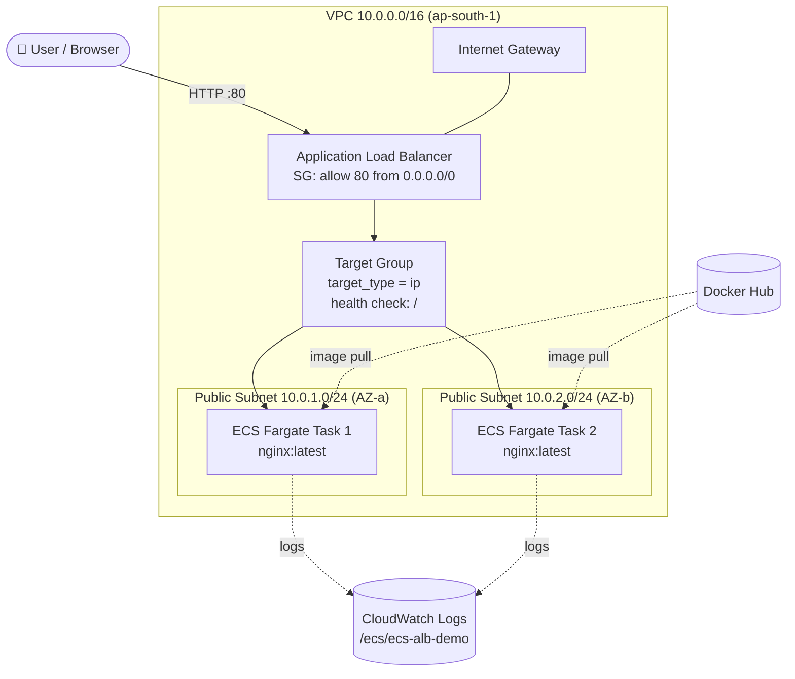
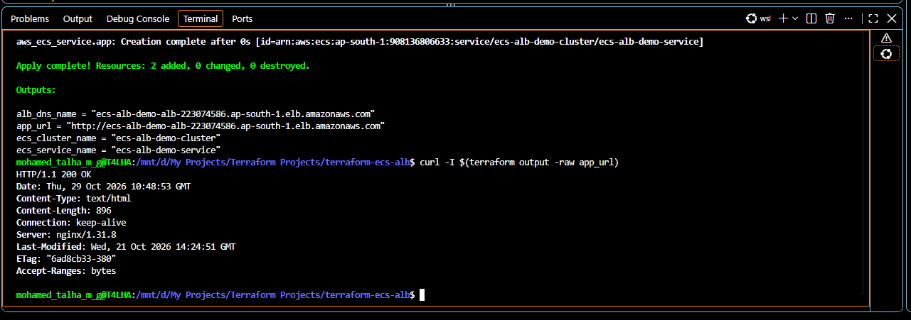
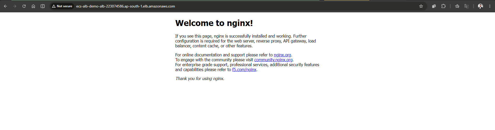
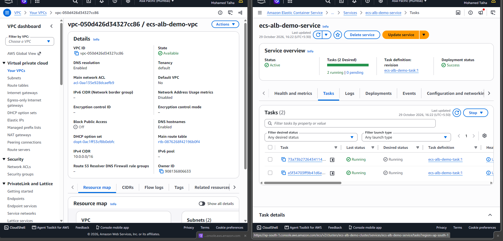
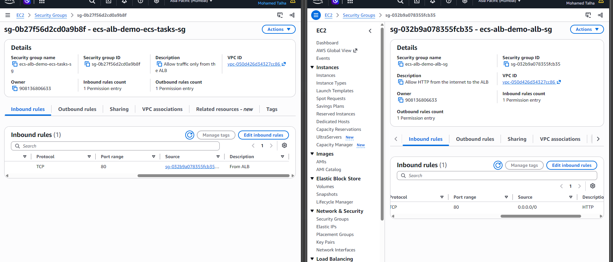
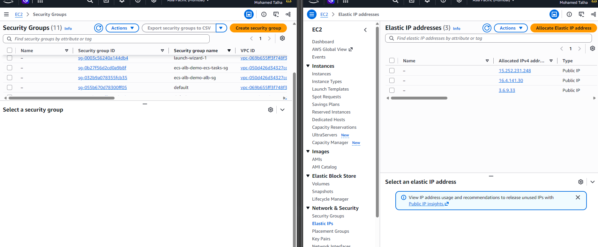

# Terraform · AWS ECS Fargate with Application Load Balancer
 


 
Infrastructure as Code that deploys a Dockerized web application to **AWS ECS on Fargate**, running **2 tasks across 2 Availability Zones** behind an internet-facing **Application Load Balancer**. Everything (networking, security, IAM, logging, compute and load balancing) is provisioned with Terraform from a single `terraform apply`.
 
---
 
## 📌 Highlights
 
- **Custom VPC** with public subnets in two Availability Zones for high availability
- **Serverless containers** with ECS Fargate, so there are no EC2 instances to patch or scale
- **Application Load Balancer** distributing traffic across tasks, with health checks
- **Least-privilege networking**: tasks accept traffic **only from the ALB security group**, never directly from the internet
- **Self-healing**: ECS keeps 2 healthy tasks running and replaces any that fail
- **Centralised logging** to Amazon CloudWatch Logs
- **Fully parameterised**: region, image, port, CPU/memory and task count are all variables
- **18 AWS resources** managed as code, created and destroyed with one command
---
 
## 🏗️ Architecture
 

 
**Request flow:** User → ALB (port 80) → Listener → Target Group → one of the 2 Fargate tasks (port 80) → nginx response.
 
---
 
## 🧰 Tech Stack
 
| Category | Tools |
|---|---|
| Infrastructure as Code | Terraform (>= 1.5), AWS Provider (~> 5.0) |
| Cloud | AWS: VPC, EC2 (Security Groups), ELB, ECS Fargate, IAM, CloudWatch |
| Containers | Docker (`nginx:latest` from Docker Hub) |
| Environment | Ubuntu (WSL), AWS CLI, VS Code |
 
---
 
## 📁 Project Structure
 
```
terraform-aws-ecs-fargate-alb/
├── providers.tf              # Terraform + AWS provider config, default tags
├── variables.tf              # All input variables with defaults
├── vpc.tf                    # VPC, Internet Gateway, public subnets, route table
├── security_groups.tf        # ALB SG and ECS tasks SG
├── alb.tf                    # Application Load Balancer, target group, listener
├── ecs.tf                    # ECS cluster, IAM execution role, log group, task definition, service
├── outputs.tf                # ALB DNS name, app URL, cluster and service names
├── terraform.tfvars.example  # Sample variable values
├── screenshots/              # Deployment evidence
└── README.md
```
 
### Resources created
 
| File | Resources |
|---|---|
| `vpc.tf` | `aws_vpc`, `aws_internet_gateway`, `aws_subnet` ×2, `aws_route_table`, `aws_route_table_association` ×2 |
| `security_groups.tf` | `aws_security_group` ×2 (ALB, ECS tasks) |
| `alb.tf` | `aws_lb`, `aws_lb_target_group`, `aws_lb_listener` |
| `ecs.tf` | `aws_ecs_cluster`, `aws_iam_role`, `aws_iam_role_policy_attachment`, `aws_cloudwatch_log_group`, `aws_ecs_task_definition`, `aws_ecs_service` |
 
---
 
## ⚙️ Input Variables
 
| Variable | Description | Default |
|---|---|---|
| `aws_region` | AWS region to deploy into | `ap-south-1` |
| `project_name` | Prefix for all resource names | `ecs-alb-demo` |
| `vpc_cidr` | CIDR block for the VPC | `10.0.0.0/16` |
| `public_subnet_cidrs` | One public subnet per AZ | `["10.0.1.0/24", "10.0.2.0/24"]` |
| `container_image` | Docker Hub image or ECR URI | `nginx:latest` |
| `container_port` | Port the container listens on | `80` |
| `task_cpu` | Fargate task CPU units | `256` |
| `task_memory` | Fargate task memory (MiB) | `512` |
| `desired_count` | Number of running tasks | `2` |
 
## 📤 Outputs
 
| Output | Description |
|---|---|
| `alb_dns_name` | DNS name of the Application Load Balancer |
| `app_url` | Full URL to open the app in a browser |
| `ecs_cluster_name` | Name of the ECS cluster |
| `ecs_service_name` | Name of the ECS service |
 
---
 
## 🚀 Getting Started
 
### Prerequisites
 
- [Terraform](https://developer.hashicorp.com/terraform/install) >= 1.5
- [AWS CLI](https://docs.aws.amazon.com/cli/latest/userguide/getting-started-install.html) configured with `aws configure`
- An IAM user with permissions for VPC, EC2, ELB, ECS, IAM and CloudWatch Logs
### Deploy
 
```bash
git clone https://github.com/mohamed-talha-m-g/terraform-aws-ecs-fargate-alb.git
cd terraform-aws-ecs-fargate-alb
 
# Optional: customise values
cp terraform.tfvars.example terraform.tfvars
 
terraform init
terraform fmt -recursive
terraform validate
terraform plan
terraform apply
```
 
After `apply` completes, wait 1–2 minutes for the targets to pass health checks, then open the `app_url` output in a browser.
 
### Verify
 
```bash
# App responds through the ALB
curl -I $(terraform output -raw app_url)
 
# Desired vs running task count
aws ecs describe-services \
  --cluster $(terraform output -raw ecs_cluster_name) \
  --services $(terraform output -raw ecs_service_name) \
  --query "services[0].{desired:desiredCount,running:runningCount}"
```
 
---
 
## 📸 Screenshots
 
### 1. Terraform apply output and `curl` check
Terraform outputs the ALB DNS name, and `curl` against the ALB returns `HTTP/1.1 200 OK` from nginx.
 

 
### 2. Application running in the browser via the ALB DNS name
 

 
### 3. Custom VPC and ECS service with 2/2 tasks running
The VPC `ecs-alb-demo-vpc` (10.0.0.0/16) and the ECS service showing status **Active**, deployment **Success**, and **2 running / 0 pending** tasks.
 

 
### 4. Security group rules (least privilege)
The **ECS tasks SG** only allows TCP 80 from the **ALB security group** (left). The **ALB SG** allows TCP 80 from the internet (right).
 

 
### 5. Security groups created in the project VPC
 

 
---
 
## 🧠 Key Design Decisions
 
| Decision | Reason |
|---|---|
| **Fargate** instead of EC2 launch type | No servers to manage, patch or scale; you pay per task |
| **`target_type = "ip"`** on the target group | Required for Fargate, because tasks use `awsvpc` networking and each gets its own ENI and IP |
| **SG-to-SG reference** for task ingress | Containers are reachable only through the ALB, never directly from the internet |
| **Public subnets + `assign_public_ip`** | Lets tasks pull images from Docker Hub without a NAT Gateway, keeping lab cost low |
| **`depends_on` on the ECS service** | Makes sure the listener and IAM policy exist before ECS registers targets |
| **`jsonencode()` for container definitions** | Write the definition in HCL while Terraform produces the JSON ECS expects |
| **`default_tags`** in the provider | Tags every resource consistently without repeating tag blocks |
 
### Production improvements
 
- Move tasks to **private subnets** with a NAT Gateway or VPC endpoints (ECR, CloudWatch, S3)
- Add **HTTPS** with an ACM certificate and redirect HTTP → HTTPS
- Add **ECS Service Auto Scaling** based on CPU or ALB request count
- Store state remotely in **S3 with DynamoDB locking**
- Build and push a custom image to **Amazon ECR** through a **CI/CD pipeline** (GitHub Actions or Jenkins)
- Refactor into reusable **Terraform modules** (network, alb, ecs)
---
 
## 🛠️ Troubleshooting Notes
 
Real issues I hit while building this project, and how I fixed them:
 
| Error | Cause | Fix |
|---|---|---|
| `Invalid version constraint` | Typed a backtick instead of `~` in `~> 5.0` | Use the pessimistic constraint operator `~>` |
| `Inappropriate value for attribute "route": set of object required` | Wrote `route = { ... }` | Nested blocks take no `=`: `route { ... }` |
| `is not a valid CIDR block` | Extra dot in `10.0.1.0./24` | Fixed the value in `variables.tf`; the error points to where the variable is *used* |
| `Reference to undeclared resource` | Reference name didn't match the resource label | Keep `<type>.<name>` consistent across files |
| `MalformedPolicyDocument: Invalid principal` | `ecs-task.amazonaws.com` | Correct service principal is `ecs-tasks.amazonaws.com` |
| `Log driver awslogs disallows options` | Misspelled `awslogs-stream-prefix` | Values inside `jsonencode()` are only checked by AWS at `apply`, so check key names carefully |
 
**Lesson:** `terraform validate` catches syntax, reference and type errors. AWS-side values such as service principals and ECS JSON keys only fail at `apply`.
 
---
 
## 💰 Cost and Cleanup
 
The ALB and Fargate tasks are billed hourly. Destroy everything when you're done:
 
```bash
terraform destroy
```
 
---
 
## 👤 Author
 
**Mohamed Talha M G**: DevOps & Cloud Engineer
🔗 [GitHub](https://github.com/mohamed-talha-m-g) · [LinkedIn](https://www.linkedin.com/in/mohamed-talha-m-g)
 
If you found this project useful, consider giving it a ⭐